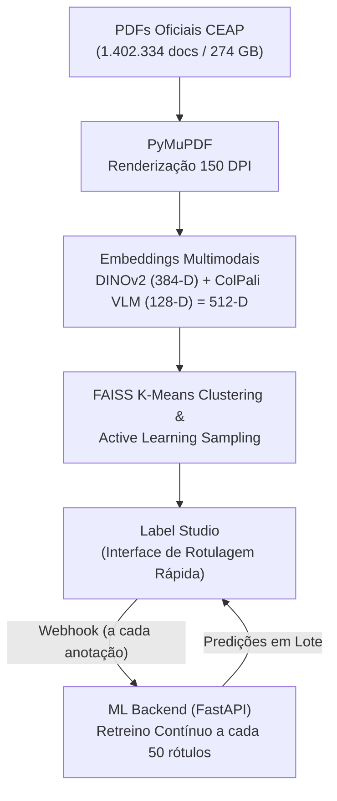

# CEAP Document Classification & Active Learning Pipeline

Repositório de pesquisa de Mestrado dedicado à classificação multimodal, agrupamento visual e rotulagem ativa (Active Learning) de comprovantes de despesas públicas da **Cota para o Exercício da Atividade Parlamentar (CEAP)** da Câmara dos Deputados (2014–2026).

---

## 1. Estatísticas Oficiais do Dataset CEAP

O dataset reúne os comprovantes fiscais digitalizados (PDFs) submetidos por deputados federais e disponibilizados no Portal de Dados Abertos da Câmara dos Deputados.

### Visão Geral Consolidada

| Métrica | Valor Consolidado |
| :--- | :--- |
| **Período Coberto** | **2014 a 2026** (13 anos) |
| **Total de PDFs Esperados** | **1.406.013** documentos |
| **Total de PDFs Baixados com Sucesso** | **1.402.334** documentos (**99,74%**) |
| **Total de Falhas no Download (Ausentes)** | **3.679** documentos (**0,26%**) |
| **Espaço Total em Disco Ocupado** | **274 GB** (armazenado em `/media/ssd2/datasets/CEAP/`) |
| **Páginas por Documento** | Mín: **0** \| Média: **1,49** \| Mediana: **1,00** \| Máx: **88** |
| **Tamanho por Arquivo** | Mín: **15 B** \| Média: **202,3 KB** \| Mediana: **122,2 KB** \| Máx: **1,37 MB** |
| **PDFs Válidos e Renderizáveis (OK)** | **1.402.313** (**99,9985%** dos baixados) |
| **PDFs Protegidos por Senha** | **1** único arquivo (`6946208.pdf`) |
| **PDFs Corrompidos / 0 páginas** | **10** arquivos |
| **Arquivos Inválidos (Não-PDF)** | **10** arquivos (apenas trailer sem cabeçalho `%PDF-`) |
| **Falhas de Renderização de Operadores** | **0** (100% dos válidos renderizam perfeitamente) |

---

### Quantidade de Documentos e Taxa de Sucesso por Ano

| Ano | Total Esperado | Baixados com Sucesso | Falhas / Ausentes | Taxa de Sucesso | Taxa de Falha |
| :---: | :---: | :---: | :---: | :---: | :---: |
| **2014** | 73.376 | 73.326 | 50 | **99,93%** | 0,07% |
| **2015** | 189.280 | 188.539 | 741 | **99,61%** | 0,39% |
| **2016** | 182.161 | 182.067 | 94 | **99,95%** | 0,05% |
| **2017** | 174.326 | 172.223 | 2.103 | **98,79%** | 1,21% |
| **2018** | 87.994 | 87.938 | 56 | **99,94%** | 0,06% |
| **2019** | 105.256 | 105.194 | 62 | **99,94%** | 0,06% |
| **2020** | 77.937 | 77.856 | 81 | **99,90%** | 0,10% |
| **2021** | 91.160 | 91.040 | 120 | **99,87%** | 0,13% |
| **2022** | 82.768 | 82.696 | 72 | **99,91%** | 0,09% |
| **2023** | 91.703 | 91.654 | 49 | **99,95%** | 0,05% |
| **2024** | 95.780 | 95.649 | 131 | **99,86%** | 0,14% |
| **2025** | 91.583 | 91.509 | 74 | **99,92%** | 0,08% |
| **2026** | 62.689 | 62.643 | 46 | **99,93%** | 0,07% |
| **TOTAL** | **1.406.013** | **1.402.334** | **3.679** | **99,74%** | **0,26%** |

---

### Estatísticas de Número de Páginas

A imensa maioria dos comprovantes é de **página única** (cupons fiscais, recibos, DANFEs, passagens aéreas e faturas sintéticas).

| Ano | Mínimo | Média | Mediana | Máximo |
| :---: | :---: | :---: | :---: | :---: |
| **2014** | 1 | 1,18 | 1 | 17 |
| **2015** | 1 | 1,26 | 1 | 68 |
| **2016** | 0 | 1,33 | 1 | 40 |
| **2017** | 0 | 1,46 | 1 | 36 |
| **2018** | 0 | 1,29 | 1 | 23 |
| **2019** | 1 | 1,52 | 1 | 75 |
| **2020** | 1 | 1,58 | 1 | 88 |
| **2021** | 1 | 1,65 | 1 | 33 |
| **2022** | 1 | 1,63 | 1 | 44 |
| **2023** | 0 | 1,64 | 1 | 56 |
| **2024** | 1 | 1,68 | 1 | 50 |
| **2025** | 1 | 1,71 | 1 | 58 |
| **2026** | 0 | 2,05 | 1 | 70 |
| **GERAL** | **0** | **1,49** | **1** | **88** |

---

### Estatísticas de Tamanho de Arquivo

| Ano | Mínimo | Média | Mediana | Máximo |
| :---: | :---: | :---: | :---: | :---: |
| **2014** | 5,8 KB | 119,1 KB | 62,4 KB | 1,00 MB |
| **2015** | 2,2 KB | 125,5 KB | 64,2 KB | 1,00 MB |
| **2016** | 71 B | 130,0 KB | 69,9 KB | 1,00 MB |
| **2017** | 70 B | 156,8 KB | 88,2 KB | 1,00 MB |
| **2018** | 15 B | 161,5 KB | 91,1 KB | 1,00 MB |
| **2019** | 15 B | 206,2 KB | 137,1 KB | 1,00 MB |
| **2020** | 1,2 KB | 240,9 KB | 164,7 KB | 1,00 MB |
| **2021** | 1,2 KB | 269,7 KB | 196,1 KB | 1,00 MB |
| **2022** | 1,3 KB | 294,0 KB | 235,5 KB | 1,37 MB |
| **2023** | 1,5 KB | 278,6 KB | 224,4 KB | 1,00 MB |
| **2024** | 1,5 KB | 282,5 KB | 234,8 KB | 1,00 MB |
| **2025** | 1,2 KB | 284,3 KB | 224,5 KB | 1,00 MB |
| **2026** | 3,2 KB | 295,3 KB | 218,9 KB | 1,00 MB |
| **GERAL** | **15 B** | **202,3 KB** | **122,2 KB** | **1,37 MB** |

> **Nota:** Para o detalhamento completo dos 21 arquivos anômalos identificados (10 quebrados, 10 sem cabeçalho e 1 com senha), consulte [DATASET_CEAP.md](DATASET_CEAP.md).

---

## 2. Taxonomia de Classes Documentais

A taxonomia foi definida a partir da análise da distribuição empírica dos dados e das subcotas da Câmara:

| Tecla / Atalho | Classe | Descrição |
| :---: | :--- | :--- |
| **`1`** | `nfc` | Nota Fiscal de Consumidor Eletrônica (NFC-e / Cupom Fiscal de posto, alimentação, etc.) |
| **`2`** | `nfe` | Nota Fiscal Eletrônica mercantil (NF-e / DANFE padrão A4 com grade de produtos) |
| **`3`** | `nfse` | Nota Fiscal de Serviços Eletrônica municipal (NFS-e de consultoria, assessoria, serviços) |
| **`4`** | `recibo` | Recibos em geral (táxi, pedágio, estacionamento, locação simples) |
| **`5`** | `emails` | E-mails, trocas de mensagens e correspondências anexadas |
| **`6`** | `energia` | Faturas e contas de energia elétrica / luz |
| **`7`** | `agua` | Faturas e contas de água e saneamento básico |
| **`8`** | `boleto` | Boletos bancários de cobrança e compensação |
| **`9`** | `fatura_cartao_credito` | Faturas e demonstrativos mensais de cartão de crédito |
| **`0`** | `uber` | Recibos e comprovantes de viagens de aplicativo (Uber, 99, etc.) |
| **`a`** | `aviao` | Passagens aéreas, bilhetes e cartões de embarque (GOL, LATAM, Azul) |
| **`c`** | `fatura_internet_celular` | Faturas e contas de telefonia celular, fixa e pacotes de internet |
| **`i`** | `invoice` | Invoices comerciais internacionais e faturas em moeda estrangeira |
| **`f`** | `fatura` | Faturas comerciais de cobrança geral, locação de veículos e serviços |

---

## 3. Arquitetura do Pipeline



### Componentes Principais:
1. **Representação Densa (512-D):**
   * **DINOv2 (Vision Transformer):** 384 dimensões capturando layout visual e geometria.
   * **ColPali (Vision-Language Model):** 128 dimensões projetadas para relevância semântica multimodal.
2. **ML Backend Reativo (FastAPI):**
   * Classificador linear leve (`LogisticRegression`) com tempo de retreino inferior a 0,5 segundo.
   * **Retreino Contínuo:** Retreina automaticamente a cada **50 novas anotações** submetidas no Label Studio.
   * **Sincronização Ativa de Predições:** Após o retreino, atualiza as predições de todas as tarefas pendentes na fila em segundo plano.
3. **Active Learning & Priorização:**
   * Script de amostragem por distância ao centroide do cluster (permite explorar regiões de alta incerteza ou focar em clusters limítrofes).
   * Suporte à validação em lote através de links simbólicos com ordenação por confiança.

---

## 4. Executando Localmente

### Pré-requisitos
* Python 3.12+ (gerenciado via `uv`)
* Docker e Docker Compose

### Subindo os Serviços (Label Studio + ML Backend)
```bash
docker compose -f docker-compose.labelstudio.yml up -d
```

* **Label Studio:** `http://localhost:8085` (Login: `admin@ceap.com` / `ceap-admin-2026`)
* **ML Backend:** `http://localhost:9090` (Healthcheck: `GET /health`)

### Testes Automatizados
```bash
uv run pytest tests/test_ml_backend.py
```
