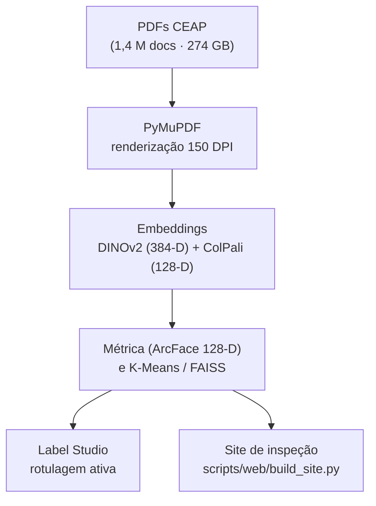

# CEAP · Classificação, clusterização e rotulagem ativa

Pesquisa de Mestrado sobre comprovantes fiscais da **Cota para o Exercício da Atividade Parlamentar (CEAP)** da Câmara dos Deputados (2014–2026): download, representação multimodal, clusterização e rotulagem ativa com Label Studio.

> Estatísticas do dataset, taxonomia de classes e benchmark de extração: [`docs/DATASET_CEAP.md`](docs/DATASET_CEAP.md).

---

## Estrutura

```
masters-data/
├── src/dados/          biblioteca importável (testada)
│   ├── config.py       caminhos centrais (única fonte de verdade)
│   ├── ceap/           download dos metadados e dos PDFs
│   ├── clustering/     K-Means / FAISS, merge de clusters
│   ├── extraction/     avaliação de extração, cliente Gemini
│   ├── labeling/       tarefas do Label Studio, amostragem
│   ├── visualization/  projeções 3D e galerias
│   ├── metric_learning/ ArcFace / projeção métrica
│   ├── database/       importação no PostgreSQL
│   └── web/            gerador de dados do site de inspeção
├── scripts/            entry points (um por etapa)
│   ├── clustering/     geração de espaços latentes e jobs Slurm
│   ├── extraction/     extração com LightOnOCR / VLM e benchmarks
│   ├── validation/     lotes de validação manual (batches/ e triage/)
│   ├── labeling/       preparação do dataset de rotulagem
│   └── web/            site, dados do espaço latente e deploy (Vercel)
├── tests/              testes unitários (pytest)
├── data/               dados em camadas (ver abaixo)
├── web/                site estático de inspeção
├── sql/                esquema do banco
└── docs/               documentação do dataset e figuras
```

**Regra:** o que é importado por testes ou por outro módulo fica em `src/dados/`; o que é executado diretamente fica em `scripts/`.

### Camadas de dados

| Pasta | Conteúdo | Versionado |
| :--- | :--- | :---: |
| `data/raw/` | `Ano-*.json(.zip)` da Câmara, amostra de PDFs | não |
| `data/processed/` | embeddings, `.npz`, tarefas do Label Studio | não |
| `data/models/` | histórico de anotações, cabeça de projeção métrica | parcial |
| `data/labeling/` | decisões aceitas por classe | não |
| `data/reports/` | clusterizações (`clusters/`) e visualizações 3D (`visualizations/`) | sim |
| `data/evaluation/` | relatórios de avaliação e benchmark | sim |

Os ~1,4 M PDFs ficam fora do repositório, em `CEAP_PDF_DIR` (padrão `/media/ssd2/datasets/CEAP`). As pastas de validação manual vão para `CEAP_DESKTOP_DIR` (padrão `~/Desktop`).

---

## Instalação

Pré-requisito: [`uv`](https://docs.astral.sh/uv/).

```bash
uv sync --all-groups                 # núcleo + testes
uv sync --all-groups --all-extras    # tudo (torch, OCR, Gemini, API)
```

Os extras são opcionais: `pdf`, `ocr`, `ml`, `viz`, `gemini`.

---

## Comandos principais

```bash
# Testes
uv run pytest

# Download dos metadados (Ano-*.json.zip, 2014–2026) para data/raw/
uv run ceap-download-metadata

# Download dos PDFs listados nos JSONs (requer armazenamento externo)
CEAP_PDF_DIR=/caminho/para/pdfs uv run ceap-download-pdfs

# O mesmo download em um job Slurm: ajuste DEST e REPO em scripts/ceap/slurm_download_pdfs.sh

# Gerar os dados do site e abri-lo localmente
uv run python scripts/web/build_site.py
cd web && python3 -m http.server 8000     # http://localhost:8000

# Clusterização em cluster Slurm
bash scripts/clustering/submit_cluster_jobs.sh

# Label Studio
docker compose -f docker-compose.labelstudio.yml up -d
```

Os scripts devem ser executados a partir da raiz do repositório (os caminhos relativos dependem disso).

---

## Site de inspeção (`web/`)

Site estático, sem framework nem etapa de build. Mostra:

- **Visão geral** — contagens consolidadas e ambientes.
- **Ambientes** — cada clusterização, seus clusters, subcotas dominantes e miniaturas dos documentos.
- **Documentos** — busca e filtro por classe nos 25.716 documentos do dataset de rotulagem.
- **Espaço latente** — projeção 3D (Three.js) dos 1,34 M pontos nos quatro espaços: DINOv2, ColPali, combinado e métrico.
- **Tarefas** — anotações por classe e status do dataset.
- **Resultados** — relatórios de avaliação e benchmark.
- **Modelos** — espaços comparados e artefatos treinados.
- **Logs** — últimas 200 linhas de `slurm-*.out` e `*.log`.
- **Arquivos** — catálogo de todos os artefatos, com pré-visualização de JSON, CSV e Markdown.

### Desempenho

O site foi desenhado para carregar pouco e sob demanda:

| Item | Tamanho aproximado |
| :--- | ---: |
| `data/manifest.json` + JSONs de ambientes/modelos/logs | ~200 KB |
| Miniaturas WebP (650 documentos, 360 px) | ~8 MB |
| Dataset do espaço latente (`plotly_dataset.json.gz`) | 1,8 MB |
| Pontos do espaço latente (`data/latent/`, só nessa página) | ~60 MB |

As miniaturas são geradas a partir dos PNGs originais (187 MB). `data/processed/web_legacy/` guarda os arquivos de origem dos pontos do espaço latente.

Para publicar no Vercel: `uv run python scripts/web/deploy_to_vercel.py`.

---

## Pipeline



---

## Desenvolvimento

- Caminhos: sempre a partir de `dados.config`, nunca absolutos. Variáveis de ambiente: `CEAP_PDF_DIR`, `CEAP_DESKTOP_DIR`.
- Lint de correção: `uv run ruff check --select F,E9 src scripts tests` (nomes indefinidos, imports mortos, erros de sintaxe).
- Novo script: coloque a lógica reutilizável em `src/dados/<área>/` com teste em `tests/`, e deixe em `scripts/<etapa>/` apenas a casca de linha de comando.
